<!--
  BEFORE YOU PUBLISH
  1. The repository must be named exactly like your GitHub username (for example sarawaleed/sarawaleed).
  2. Replace every YOUR_USERNAME below with your GitHub username.
  3. Fill in the [ brackets ] on the character sheet: edit build_character() in tools/build_assets.py,
     then run  python3 tools/build_assets.py  to regenerate the images in /assets.
  4. Add your own skills in ARSENAL, your own projects in LEGENDARY BUILDS, and your links in TRANSMISSION CHANNELS.
-->

<div align="center">


<br />

<a href="https://omarmetman.vercel.app/projects/whisper"></a>
<a href="https://github.com/YOUR_USERNAME"></a>

<br />


</div>

<br />


<div align="center">


</div>

<details>
<summary><b>View the source of this character</b></summary>

```javascript
const sara = {
  origin: "[ Your city, Country ]",
  class: "Software Developer",
  level: "[ Years of experience ]",
  education: "[ Your degree @ Your university ]",
  signatureBuild: "Whisper (co-forged with Omar M. Etman)",
  forgedInWhisper: ["Real-time chat", "AI oracle", "Offline mode", "Bilingual"]
};
```

</details>

<br />


<div align="center">

<!--
  Add your skills by listing their ids after i= (browse all ids at https://skillicons.dev),
  for example: i=js,ts,react,nodejs,python,git,github
-->


</div>

<br />


<div align="center">


<picture>
  <source media="(prefers-color-scheme: dark)" srcset="./profile-3d-contrib/profile-night-rainbow.svg" />
  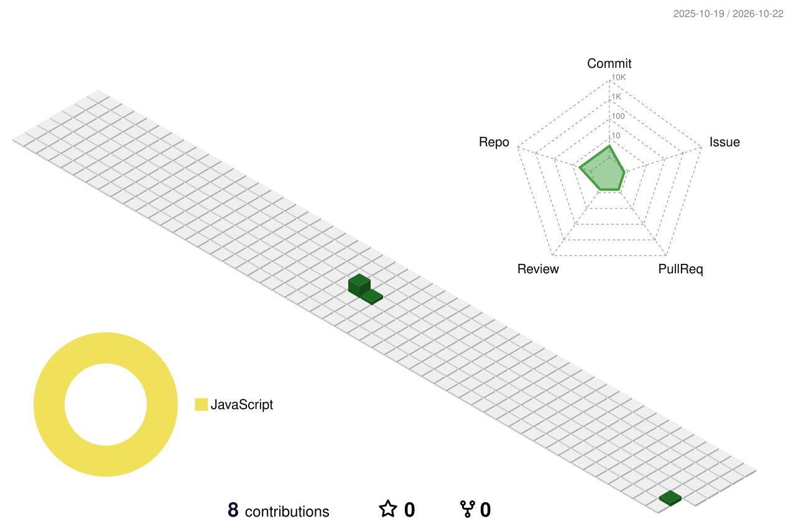
</picture>

<picture>
  <source media="(prefers-color-scheme: dark)" srcset="https://raw.githubusercontent.com/YOUR_USERNAME/YOUR_USERNAME/output/github-snake-dark.svg" />
  
</picture>

</div>

<br />


<div align="center">

<a href="https://omarmetman.vercel.app/projects/whisper"></a>

<!--
  Add your own projects here. A ready-made template card lives at assets/card-your-project.svg
  (see the commented example in tools/build_assets.py). Two cards fit side by side:

  <a href="https://github.com/YOUR_USERNAME/YOUR_REPO"></a>
-->

</div>

<br />


<div align="center">

<a href="https://github.com/YOUR_USERNAME"></a>
<a href="https://www.linkedin.com/in/YOUR_LINKEDIN"></a>
<a href="mailto:you@example.com"></a>

<br /><br />


</div>
